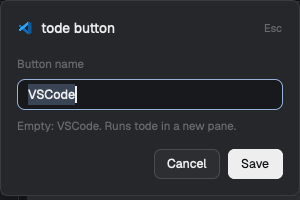

# tode for Herdr

A [Herdr](https://herdr.dev) mod: a button in the tab bar that opens
[`tode`](#requirements) (terminal code) in the focused terminal's folder: in a new tab (the
default), a new pane beside it, or a popup window.


- **The button** says **VSCode** by default, with a small icon in the style of VS Code's
  (drawn for this mod; it is not Microsoft's logo file). Like the tab bar's other icons it has
  one color, the button's text color; the fold shows as lighter and darker parts. Click it and
  `tode` starts in the focused terminal's folder, where the settings say:
  - **New tab** (default): a new tab in the space.
  - **New pane**: a pane to the right of the focused one (a new tab if no pane is focused).
  - **Popup window**: a Herdr window over the layout, 72% × 78% of the app, with a title bar
    (icon, "tode", the folder, × to close). Drag it by the title bar; it remembers nothing and
    closes when `tode` ends. The terminal is outside Herdr's tabs and is removed when it ends.

  Closing `tode` closes its tab, pane or window.
- **Named after the button**, with the blue icon: a new tab and its pane are called what the
  button says (`VSCode`), and so is a new pane; the popup's title bar says it too. The icon in
  front is the blue version of the button's icon (`icon-color.svg`), from the `tode` entry in
  `programs.json` (see Install). Tabs and panes are named once, when they open.
- **Right-click the button** for its settings: a small form opens at the pointer (the
  button's tooltip says so) with the button's **name** and where tode **opens** (New tab, New
  pane, Popup window). **Save** (or Enter) keeps them, **Cancel** (or Esc) doesn't; an empty
  name goes back to **VSCode**. Both are kept in Herdr's shared state (`shared("tode.label")`,
  `shared("tode.open")`), so they are still there after a restart, and other mods can read them.
  `mod.open tode` (or the command palette) opens the same form.
- **Keys**: the mod takes the commands `tode.open` (as set), `tode.open-tab`, `tode.open-pane`
  and `tode.open-window`, for `keys.json` (`"global": { "ctrl-shift-e": "tode.open-window" }`)
  or `herdr-app do tode.open-window`. They reach the button while it is in the shown layout.
- **Theme colors** throughout, the icon too: the bar uses `chrome`, `border`, `muted`, `hover`,
  `foreground`; the form `popover`, `input`, `accent`, `solid`.
- **Its block fits the button**: the mod measures its content and resizes its layout block
  (`layout.resize`) when the name changes.



## Requirements

[terminal-code](https://github.com/zenbu-labs/terminal-code) (VS Code inside your terminal),
which gives you `tode`. Install it with

```sh
curl -fsSL https://tode.sh/install | bash
```

If it isn't installed when you click the button, the mod says so instead of opening anything,
with that command, **Copy**, **Install in a new tab** (runs it in a tab of the focused space,
which stays open to show how it went) and a link to terminal-code on GitHub. It checks on the
focused space's machine, each click.


It needs `tode` on your `PATH` as your login shell sees it (for example `~/.local/bin/tode`). Herdr starts
a tab or pane's command in your interactive shell, so it finds what your shell finds; for the
popup the mod looks up its full path first. If the machine can't be asked, a
notification says so.

## Install

Tell your agent in Herdr:

```
Read ~/.config/herdr-app/AGENTS.md, then add this mod: github.com/sockiplastsmurfen/herdr-tode
```

Or by hand:

```sh
cp -R mods/tode ~/.config/herdr-app/mods/tode
herdr-app check ~/.config/herdr-app/mods/tode
```

For the blue icon in tabs and pane headers, add the `tode` entry from this repo's
[programs.json](programs.json) to `~/.config/herdr-app/programs.json` (merge it if you have one):

```json
{ "programs": { "tode": { "name": "tode", "icon": "mods/tode/icon-color.svg", "tint": false,
                          "match": ["tode-title", "Electron Helper"] } } }
```

Herdr names a terminal's program after what runs in it (tode is an `Electron Helper` process),
else after what started it (`tode-title`). The match on `Electron Helper` also gives other
Electron programs run straight in a terminal this icon.

Then put it in your layout, to the right of the tab bar. In a layout like Herdr's `main`, turn
the `tabs` block into a row with it (Herdr's shipped layouts are read-only: clone one first with
`herdr-app do layout.clone '{"name":"main","as":"my-main"}'`):

```json
{ "id": "tabs-row", "type": "row", "size": { "px": 42 }, "resizable": false, "children": [
  { "id": "tabs", "type": "block", "size": { "weight": 1 }, "window_drag": true, "content": { "mod": "tabs" } },
  { "id": "tode", "type": "block", "size": { "px": 120 }, "window_drag": true,
    "content": { "mod": "tode", "props": { "block": "tode" } } } ] }
```

`props.block` is the block's own id: the mod resizes that block to fit the button. Leave it out
to keep a fixed width.

The mod runs `tode`: through Herdr's `terminal.open` for a tab or pane (behind `tode-title`, a
two-line `sh` script in the mod that sets the terminal's title to the button's name), and with `hc run` (behind
`/bin/sh`, which waits for the window to show it) for the popup, after `/bin/sh -c "command -v
tode"` finds it (each click). Only when tode is missing, and you click them, it runs the install
command (which downloads from tode.sh), `pbcopy` (or `wl-copy`, `xclip`) and `open` (or
`xdg-open`) for the GitHub link. It doesn't read files.

[RECIPE.md](RECIPE.md) describes the mod for an agent that builds it from scratch.

## Tests

```sh
npm test
```

Node 20.6 or later, no dependencies. A module hook gives the mod's imports of Herdr's modules
fakes (`test/fake/gpui.mjs` keeps what a view draws so a test can find and click things,
`test/fake/herdr.mjs` the shared state, focus and layout Herdr would report, and records the
commands the mod runs).
