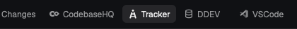
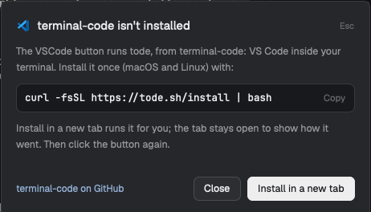

# VS Code for Herdr

A [Herdr](https://herdr.dev) mod that opens VS Code in your terminal, in the folder you are
working in. It is a **VSCode** button that you place in your layout, for example at the right
end of the tab bar. Click it and
[terminal-code](https://github.com/zenbu-labs/terminal-code) (`tode`, VS Code inside the
terminal) opens in the focused terminal's folder, in a new tab, a pane beside it or a popup
window. The new tab or pane is named after the button, with a blue icon.



## Requires terminal-code

This mod doesn't contain VS Code. It starts
[terminal-code](https://github.com/zenbu-labs/terminal-code) by zenbu-labs, which runs VS Code
(through code-server) in a terminal that can show graphics, as Herdr's can. Install it once,
on macOS or Linux:

```sh
curl -fsSL https://tode.sh/install | bash
```

The script installs the `tode` command (in `~/.local/bin`). Open a new terminal so that your
shell finds it, then check with `tode` in any folder: VS Code opens there. Upgrade later with
`tode --upgrade`, remove it with `tode --uninstall`. See
[terminal-code's README](https://github.com/zenbu-labs/terminal-code) for its options, keyboard
shortcuts (`tode --shortcut-setup`) and SSH.

Not installed yet? Click the button anyway: the mod says that terminal-code is missing and
shows the install command, with **Copy**, **Install in a new tab** (runs the command in a tab
that stays open, so you see how it went) and a link to terminal-code on GitHub.



## Install the mod

Tell your agent in Herdr:

```
Read ~/.config/herdr-app/AGENTS.md, then add this mod: github.com/sockiplastsmurfen/herdr-tode
```

Or by hand:

```sh
cp -R mods/tode ~/.config/herdr-app/mods/tode
herdr-app check ~/.config/herdr-app/mods/tode
```

**The button doesn't show until you put it in a layout.** The mod doesn't place itself
(`mod.json` says `"place": "none"`): Herdr's automatic places are whole panels along an edge of
the window, not a button in the tab bar. Put a block with `{ "mod": "tode" }` where you want the
button. An agent adding the mod does this for you; tell it where you want the button.

The suggestion: at the right end of the tab bar. In a layout like Herdr's `main`, turn the
`tabs` block into a row with the button's block after it. Herdr's shipped layouts are
read-only, so clone one first: `herdr-app do layout.clone '{"name":"main","as":"my-main"}'`.

```json
{ "id": "tabs-row", "type": "row", "size": { "px": 42 }, "resizable": false, "children": [
  { "id": "tabs", "type": "block", "size": { "weight": 1 }, "window_drag": true, "content": { "mod": "tabs" } },
  { "id": "tode", "type": "block", "size": { "px": 120 }, "window_drag": true,
    "content": { "mod": "tode", "props": { "block": "tode" } } } ] }
```

`props.block` is the block's own id: the mod resizes it to fit the button's name. Leave it out
for a fixed width.

Anywhere else works the same way: put the block before the tabs, in the status bar's row or in
the sidebar. The button is drawn to match the tab bar (its background and the line under it),
so it fits best in or next to it.

### Among the tab bar's buttons

To have the button among the tab bar's own buttons (between Changes and a button of yours, say),
your tab-bar mod draws it: Files and Changes are drawn by the tab-bar mod itself. Herdr's
shipped `tabs` is read-only, so clone it first (`herdr-app do mod.clone '{"name":"tabs","as":"my-tabs"}'`)
and point your layout's `tabs` block at the clone. In its `render`, next to Files and Changes:

```js
// VS Code for Herdr: the tode mod does the work, through an invisible popup of it.
const tode = (action) => openOverlay({ mod: "tode", props: { action }, kind: "popup", at: "pointer", frame: "none", width: 1, height: 1 });
const todeButton = h_flex().id("panel-tode").h(26).px(8).gap(5).flex_none().items_center().rounded(6)
  .text_size(12).bg(t.chrome).text_color(t.muted).hover(s => s.bg(t.hover).text_color(t.foreground))
  .tooltip("Open VS Code (tode). Right-click for settings.")
  .on_mouse_down("left", (_e, cx) => cx.stop_propagation()).on_click(() => tode("open"))
  .on_mouse_down("right", (_e, cx) => { cx.stop_propagation(); tode("settings"); })
  .child(svg("mods/tode/icon.svg").size(14)).child(shared("tode.label") || "VSCode");
```

and add `.child(todeButton)` where it should be. `action` is `"open"` (as set), `"open-tab"`,
`"open-pane"`, `"open-window"` or `"settings"`: the popup does what the button would, then
closes itself. Then leave the `tode` block out of the layout. The key commands (below) need a
shown `tode` block; without one, bind keys in your tab-bar mod instead.

For the blue icon in tabs and pane headers, add the `tode` entry from
[programs.json](programs.json) to `~/.config/herdr-app/programs.json` (merge it if you have one):

```json
{ "programs": { "tode": { "name": "tode", "icon": "mods/tode/icon-color.svg", "tint": false,
                          "match": ["tode-title", "Electron Helper"] } } }
```

Herdr names a terminal's program after what runs in it (terminal-code is an `Electron Helper`
process), else after what started it (`tode-title`). The `Electron Helper` match also gives
other Electron programs run straight in a terminal this icon.

## Use

- **Click VSCode**: VS Code opens in the focused terminal's folder. Where it opens is a setting:
  - **New tab** (the default), named after the button.
  - **New pane**, to the right of the focused one, named after the button.
  - **Popup window**: a Herdr window over the layout with a title bar (the icon, the button's
    name, the folder). Drag it by the title bar. Its buttons move VS Code into a **new tab** or a
    **pane** beside the focused one (it keeps running, named after the button), or close it (×).

  Quitting VS Code closes its tab, pane or window.
- **Already open?** If VS Code is open in the space for that folder (or a folder above it), a
  click shows it (its tab or pane, or its popup) instead of starting another one. Set it to
  **Open another** in the settings to always start a new one. Only VS Codes the button started
  count.
- **Right-click VSCode** for the settings: the button's name (empty: VSCode), where VS Code
  opens, and whether a click shows one that is already open. They are kept across restarts. The command palette's `mod.open tode` opens them too.

  
- **Keys**: bind `tode.open` (as set), `tode.open-tab`, `tode.open-pane` or `tode.open-window`
  in `keys.json`, e.g. `"global": { "ctrl-shift-e": "tode.open" }`. Herdr delivers them to a
  shown `tode` block, so they work when the button is the mod's own block.

The button follows your theme: its icon is one color, like the tab bar's other icons. The icon
is drawn for this mod in the style of VS Code's; it is not Microsoft's logo. This mod is not
made by or affiliated with Microsoft or zenbu-labs.

## What it runs

- `/bin/sh -c "command -v tode"` on each click, on the focused space's machine, to find
  terminal-code.
- `tode`, through Herdr's `terminal.open` for a tab or pane, behind `mods/tode/tode-title` (a
  three-line `sh` script that sets the terminal's title to the button's name, for pane headers
  that show the title). For the popup, through `hc run`, behind `/bin/sh`, which waits until the
  window shows the terminal (terminal-code asks the terminal about graphics as it starts).
- Only when terminal-code is missing, and you click them: the install command (it downloads from
  tode.sh), `pbcopy` (or `wl-copy`, `xclip`) for Copy, `open` (or `xdg-open`) for the GitHub link.

It labels each VS Code terminal it starts (`tode.vscode`, and `tode.space` for a popup) to find
it again. It keeps the button's name, where VS Code opens and whether to show an open one in
Herdr's shared state (`tode.label`, `tode.open`, `tode.reuse`). It reads no files.

## For developers

[RECIPE.md](RECIPE.md) describes the mod for an agent that builds it from scratch. The mod's
folder is `mods/tode/`; its Herdr name is `tode`.

```sh
npm test
```

Node 20.6 or later, no dependencies. A module hook gives the mod's imports of Herdr's modules
fakes (`test/fake/gpui.mjs` keeps what a view draws so a test can find and click things,
`test/fake/herdr.mjs` the shared state, focus, panes and layout Herdr would report, and records
the commands the mod runs).
