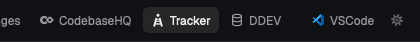

# tode

A button at the right end of the tab bar that opens `tode` (terminal code) in a new pane
beside the focused terminal, in its folder. It says **VSCode** with a small blue VS Code-style
icon; a gear beside it renames it.

## What you see

- At the right of the 42px tab-bar row, a block as wide as its content: background `chrome`,
  a 1px `border` line at the bottom (it continues the tab bar's).
- In it, left to right: the button (26px high, 8px side padding, radius 6, 12px text in
  `muted`; on hover `hover` background and `foreground` text) with a 14px icon and the name;
  then a 26×26 gear button (14px gear in `dim`; on hover `hover` and `foreground`). 10px to the
  right edge.
- The icon (`icon.svg`, 24×24, full color via `image()`): a dark blue vertical bar on the right
  (`#0b5c9e`), and two bands from its top and bottom ends crossing to the left, the upper one
  light (`#2ea6f3`) over the lower one (`#0a6fbf`). Drawn from scratch; not the VS Code logo file.
- The gear (`gear.svg`, tinted with `svg()`): a dashed thick ring (teeth), a ring and a hub.
- The form, a 300×196 popup: `popover` background, 16px padding; a header row with the icon,
  "tode button" (14px semibold) and "Esc" (`dim`); "Button name" (11.5px `dim`); a 34px input
  (radius 8, `background`, border `input`, `accent` while focused); the hint "Empty: VSCode.
  Runs tode in a new pane."; Cancel (`raised`/`input`) and Save (`solid`/`solid_foreground`)
  at the bottom right.

## How it behaves

- Click the button: `terminal.open {argv: ["tode"], place: "right", folder: focused().cwd}`.
  With no focused pane (`focused().pane` null), `place: "tab"`. Without a cwd, no folder.
- Click the gear: `openOverlay({mod: "tode", props: {settings: true}, kind: "popup",
  at: "pointer", width: 300, height: 196})`. `mod.open tode` opens the same form (mod.json's
  `overlay`): the mod draws the form whenever `props().settings` or `props().overlay` is set.
- In the form the current name is selected and focused. Enter or Save saves (trimmed) and
  closes; Esc or Cancel closes. Empty, or "VSCode", saves `null`.
- The name is `shared("tode.label")`, persisted by Herdr; the bar re-renders when it changes.
- Presses on the buttons stop propagation, so the block can be `window_drag` elsewhere.
- The block resizes itself: the content row (`flex_none`) reports its width with
  `on_size_change`; divided by `settings().zoom` and rounded up, it is sent as
  `layout.resize {id: props().block, px}` when it differs from the block's size by more than 1px.
  Not during `checking()`.

## Built from

- `mods/tode/`: `main.js` (one View, bar or form by props), `mod.json`
  (`place: "none"`, an overlay of 300×196), `icon.svg`, `gear.svg`.
- Layout: the tab bar block becomes the first child (weight 1) of a 42px row; the second child
  is `{"id": "tode", "content": {"mod": "tode", "props": {"block": "tode"}}, "window_drag": true}`.
- herdr: `run`, `focused`, `theme`, `shared`, `setShared`, `props`, `layout`, `settings`,
  `openOverlay`, `closeOverlay`, `checking`. gpui-base: `InputState`, `Input`, `h_flex`, `v_flex`.

## Watch out

- `pane.split` has no folder argument; `terminal.open` with `place: "right"` does.
- `tode` runs through the person's interactive shell, so `~/.local/bin` on its PATH is enough.
- A fixed block width cuts off long names; the self-resizing needs `props.block`.
- Don't keep a `cx`: the size handler only calls `run`.

## Done when

- `herdr-app check mods/tode` passes and `npm test` passes.
- The tab bar shows the icon, "VSCode" and a gear at its right end, in theme colors.
- Clicking the button opens a pane to the right running `tode` in the focused terminal's folder.
- Renaming in the gear's form changes the button at once, the block widens or narrows to fit,
  and the name is still there after restarting Herdr.
